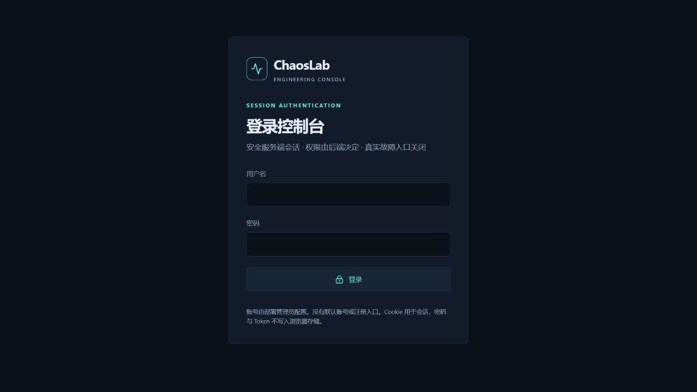
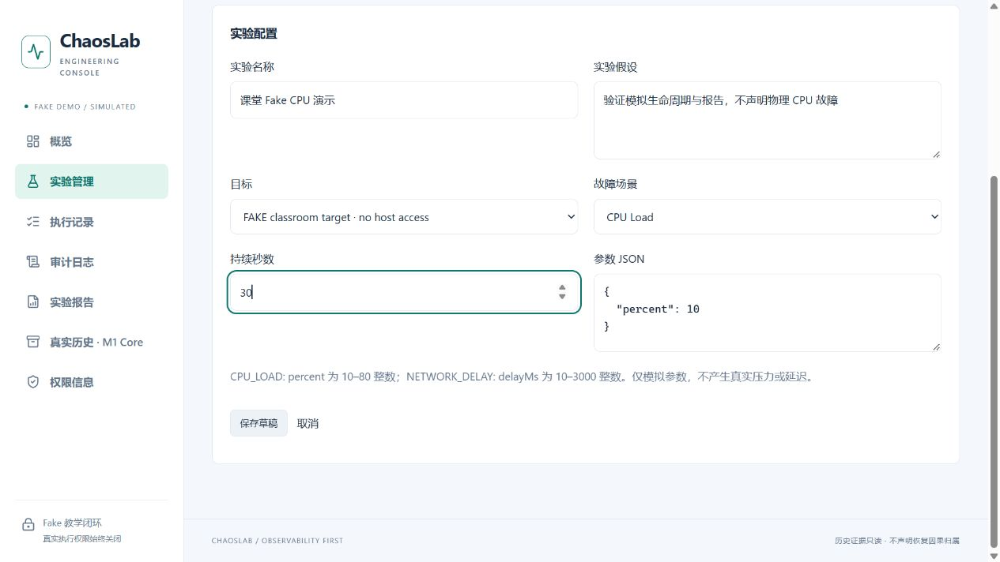
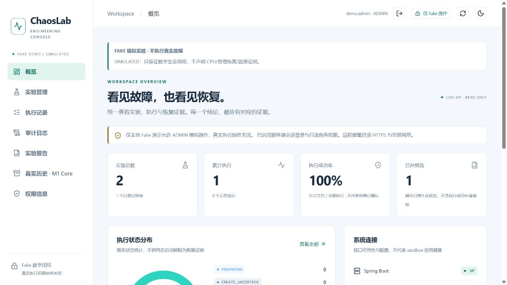
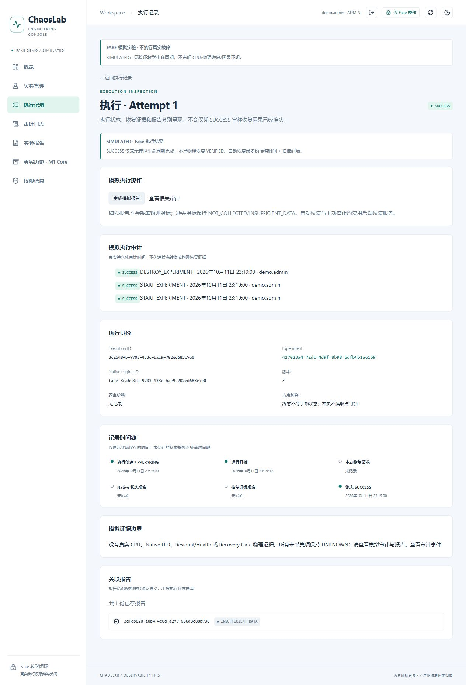
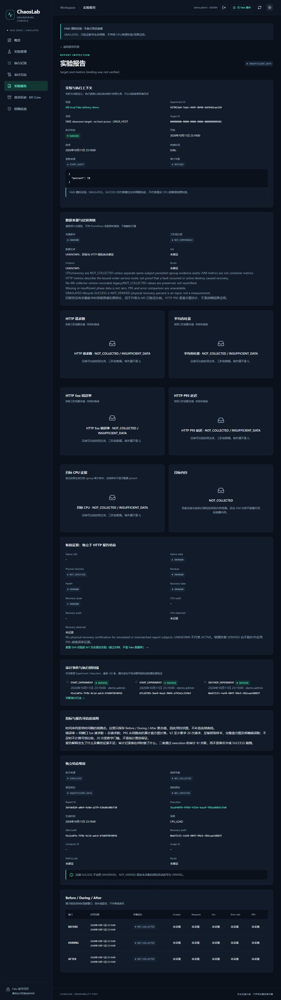
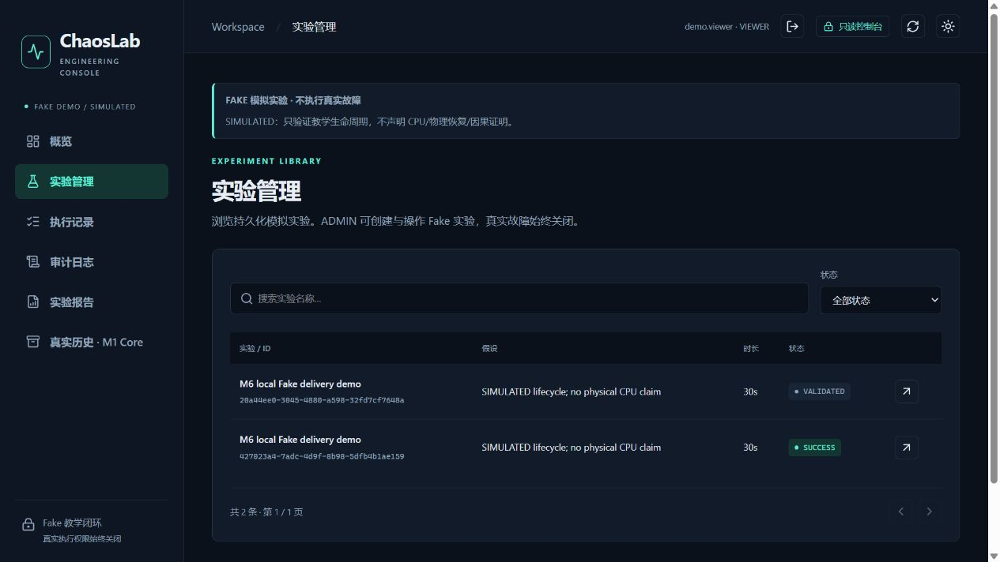
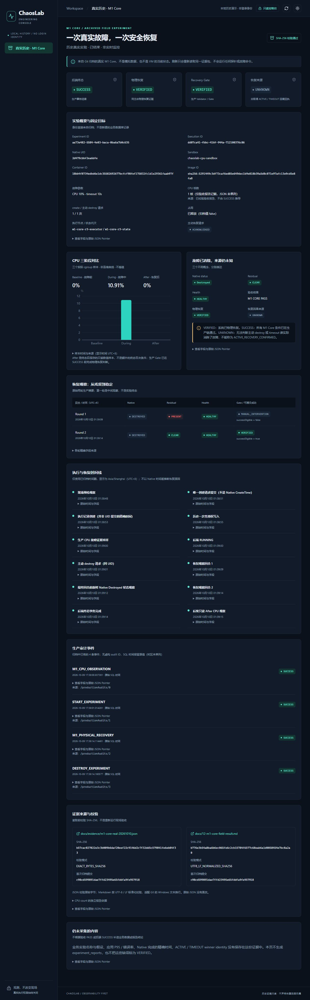

# ChaosLab

**教学型混沌工程平台｜Java 后端 + React 全栈｜安全 Fake 演示与可信真实历史**

ChaosLab 将“配置、受控执行、恢复确认、审计、报告”连成可学习的工程闭环。
混沌工程不是随意破坏，而是在明确目标、强度和停止条件下验证系统如何应对故障。
本项目区分**命令完成、模拟成功、物理恢复、恢复因果**，不把一个 SUCCESS 当作所有证据都 VERIFIED。

- 本地 Web：创建 → 校验/预检 → Fake 启动 → 主动停止/自动恢复 → 持久化报告。
- 已结束的真实 M1 Core：CPU **0% → 10.91% → 0%**，生产 Gate / physical recovery VERIFIED。
- 恢复原因仍是 **UNKNOWN**。R1/R2 原 INCOMPLETE 及 R3 原始归档保持不变。
- 普通 ADMIN **不能执行真实故障**。本地启动无需 Docker、VMware、MySQL、root 或 ChaosBlade。

## 快速开始（Windows 优先）

准备完整 **JDK 21+**（建议 21，设置 `JAVA_HOME`）、**Node.js 22.12+**（建议 24，含 npm）、Git。
首次构建需联网，Maven 无需另装；不要沿用现场部署环境变量。

```powershell
git clone https://github.com/8xbAdx8/ChaosLab.git
cd ChaosLab
# 替换为自己的实际 JDK 路径，仅设置当前终端
$env:JAVA_HOME='C:/path/to/jdk-21'
$env:PATH="$env:JAVA_HOME/bin;$env:PATH"
.\scripts\start-fake.ps1
```

Linux / macOS：

```bash
git clone https://github.com/8xbAdx8/ChaosLab.git
cd ChaosLab
# JAVA_HOME 指向你的 JDK，Node/npm 已在 PATH
bash scripts/start-fake.sh
```

首次引导你选择 ADMIN（可选 VIEWER），调用隐藏密码的 BCrypt 工具；**没有默认账号/密码**。
只保存用户名/hash 到忽略的 `.local/dev/accounts.json`，不保存明文密码。
后续无需重新配置；每次构建当前源码，固定 loopback 后端和 Vite 同源代理。
看到 READY 后打开 **http://127.0.0.1:5173/login**。

创建 Fake CPU 实验：classroom target、CPU Load、30 秒、`{"percent":10}` → 保存 → 校验 → 安全预检 →
启动并确认 → 查看执行 → 停止或等待 → 生成模拟报告。
**percent=10 是参数，不是实际 CPU 采样。** 无指标显示 NOT_COLLECTED，不填 0。
刷新/重启记录仍在独立 `.local/chaoslab-fake-demo/` H2 文件。

保留启动终端；Ctrl+C，或另开终端停止并切换独立历史演示：

```powershell
.\scripts\stop-dev.ps1
.\scripts\start-history.ps1
```

```bash
bash scripts/stop-dev.sh
bash scripts/start-history.sh
```

打开 **http://127.0.0.1:5173/history/m1-core**：无需账号或数据库，SHA 校验固定归档，
标注「历史真实实验 · 已结束 · 非实时监控」。不连接现场，不把历史记录写入 Fake 数据库。

已有账号后用 `scripts/doctor.ps1` / `bash scripts/doctor.sh fake` 单独检查。
首次账号、端口冲突、换端口、私有权限和安全停止详见 [V1 交付指南](docs/18-v1-delivery.md)。
macOS 提供 Bash 入口，目前 CI 覆盖 Windows/Ubuntu，不宣称 macOS 已验收。

## 功能与边界

| 能力                              | 当前 V1                                                                          |
| --------------------------------- | -------------------------------------------------------------------------------- |
| 配置 / Schema / SafetyGuard       | Fake Web 可操作，Controller → Service → Repository                               |
| 生命周期 / 幂等 / 占用 / 自动恢复 | 复用原状态机与事务，未知 create 不自动重试                                       |
| 登录 / RBAC                       | Session + Cookie + CSRF，VIEWER 读、ADMIN 仅本地 Fake 写                         |
| 审计 / 报告                       | 持久化记录和 ID 关联，来源、质量、缺失明确展示                                   |
| 指标                              | Micrometer；可选受信 Prometheus HTTP 窗口查询、已有 Grafana；Fake 不伪造目标指标 |
| 真实 CPU / 物理恢复               | M1 Core 独立受限环境历史 PASS，本地 Web 不开放真实操作                           |
| 历史可视化                        | 固定 SHA / JSON pointer / CPU 离散点 / 时间线 / Gate / UNKNOWN cause             |
| 交付                              | PowerShell/Bash 启动，私有账号、H2 持久化、受控停止、跨平台 CI                   |

## 技术栈

| 层     | 技术                                                                   |
| ------ | ---------------------------------------------------------------------- |
| 后端   | Java 21 / Spring Boot 4.1 / Spring Security / JPA / JDBC               |
| 数据   | Flyway V1–V11 / 本地 H2 file / 独立正式部署 MySQL                      |
| 前端   | React / TypeScript strict / Vite / Tailwind / TanStack Query / ECharts |
| 观测   | Micrometer / Prometheus / Grafana；来源、标签、窗口与采样质量验证      |
| 测试   | JUnit / MockMvc / Vitest / REST 契约 / Node 内置测试 / Go 无害 fixture |
| 自动化 | Maven Wrapper / npm lockfile / GitHub Actions Windows + Ubuntu         |

## 实际界面

下图来自**实际本地运行界面**，Fake 记录是隔离交付测试，不是现场故障证明。
历史页面读取不变的 M1 归档。版本/上下文见 [截图记录](docs/screenshots/m6/README.md)。

| 登录 / 概览                                   | 实验 / 执行                                     |
| --------------------------------------------- | ----------------------------------------------- |
|         |     |
|   |  |
|  |   |



## 安全说明

- 本地教学 V1，**不是可直接公网开放的生产系统**。绑定 127.0.0.1，无默认账号。
- ADMIN 不等于 root / REAL authorization；Fake 服务端联合验证权限、模式和实际引擎。
- 普通 console 精确 GET/HEAD 白名单；保留 SELECT-only 数据库建议。隐藏按钮不是安全边界。
- `.local/` 私有配置/日志/数据库勿上传；Unix owner-only，Windows 要使用私人目录/NTFS ACL。
- Fake SUCCESS 不等于 physical VERIFIED；缺失不补零，JVM 指标不冒充容器指标。
- 真实执行只在固定工具/SHA/目标/UID/特权边界的独立审批部署。本地脚本没有真实授权/故障入口。
- M1 已结束，R1/R2/R3 证据和历史终态不改写；时间戳不能证明恢复因果。

## 文档与演示

- [实际架构、状态机、Fake 时序、M1 证据 Mermaid 图](docs/19-v1-architecture.md)
- [5–10 分钟课堂 / 面试演示](docs/20-v1-demo.md)
- [作品集和诚实的简历描述](docs/21-portfolio.md)
- [M1 原始证据](docs/evidence/m1-core-real-20261010.json) / [验收报告](docs/12-m1-core-field-result.md)
- [M2 历史](docs/14-m2-history-demo.md) / [M3 认证](docs/15-m3-console-auth.md) / [M4 Fake](docs/16-m4-fake-demo.md) / [M5 报告](docs/17-m5-traceable-reports.md)

## 测试与复现

```powershell
.\backend\mvnw.cmd -f backend/pom.xml verify
node --test scripts/dev.test.mjs
# 独立干净测试 checkout：随机测试凭据，packaged 后端 + Vite + H2
node scripts/delivery-smoke.mjs
cd frontend
npm ci
$env:CONSOLE_CONTRACT_DIR='../backend/target'
npm test
npm run lint
npm run build
npm run build:history
```

Linux 用 `bash backend/mvnw -f backend/pom.xml verify`，契约测试用 `CONSOLE_CONTRACT_DIR=../backend/target npm test`。
原 Java/Web/root harmless CI 保留，新增交付 CI 覆盖实际启动入口、权限/CSRF、H2 重启、历史 SHA 与受控停止。
CI 不执行真实故障；结果见 [Actions](https://github.com/8xbAdx8/ChaosLab/actions)。

## 里程碑与限制

M1 Core PASS；M2 历史可视化；M3 Session/RBAC；M4 Fake Web；M5 可追溯报告；M6 V1 本地交付。
未完成：Kubernetes/Operator、多目标真实故障、ACTIVE/TIMEOUT 因果仲裁、多租户、公网生产加固。
没有虚构用户规模、吞吐量或 AI Agent 功能。

```text
backend/        Spring 服务、状态机、Repository、Flyway、测试
frontend/       React 控制台、契约/组件测试
scripts/        doctor / start / stop / 无害交付验收
docs/           架构、演示、作品集、归档证据
demo-services/  可选监控靶场（不依赖它启动本地 Fake）
tools/          已审核真实边界与无害 fixture（本地启动不运行）
```

[Apache License 2.0](LICENSE)
