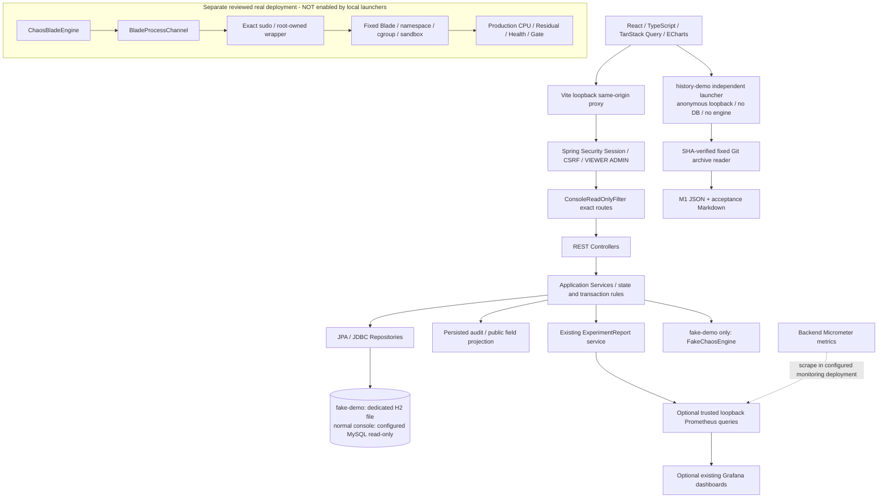
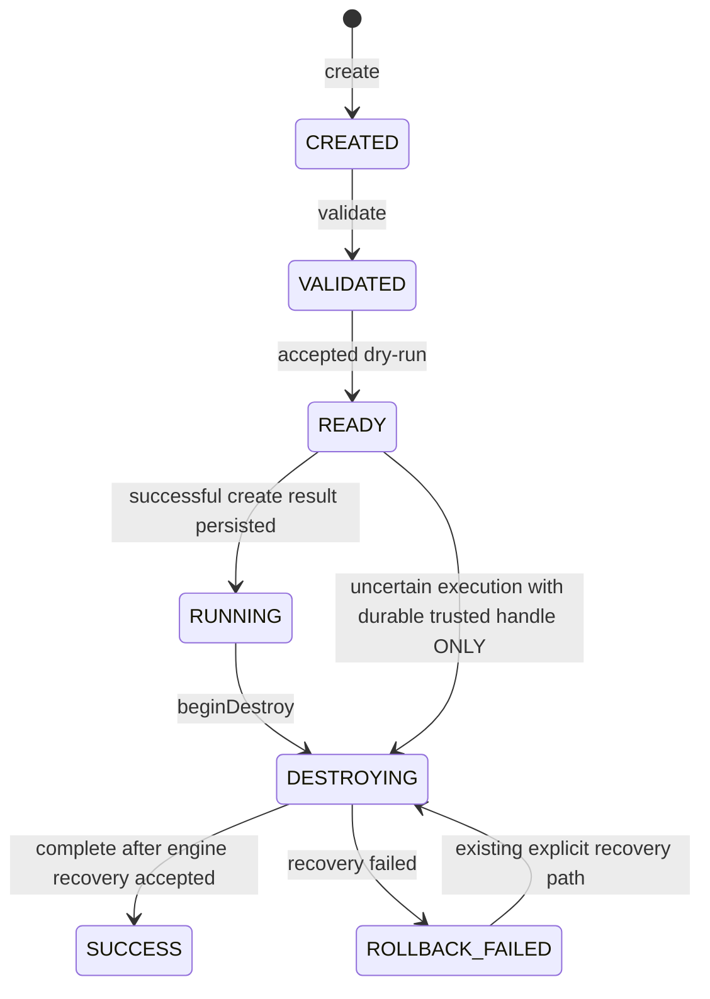
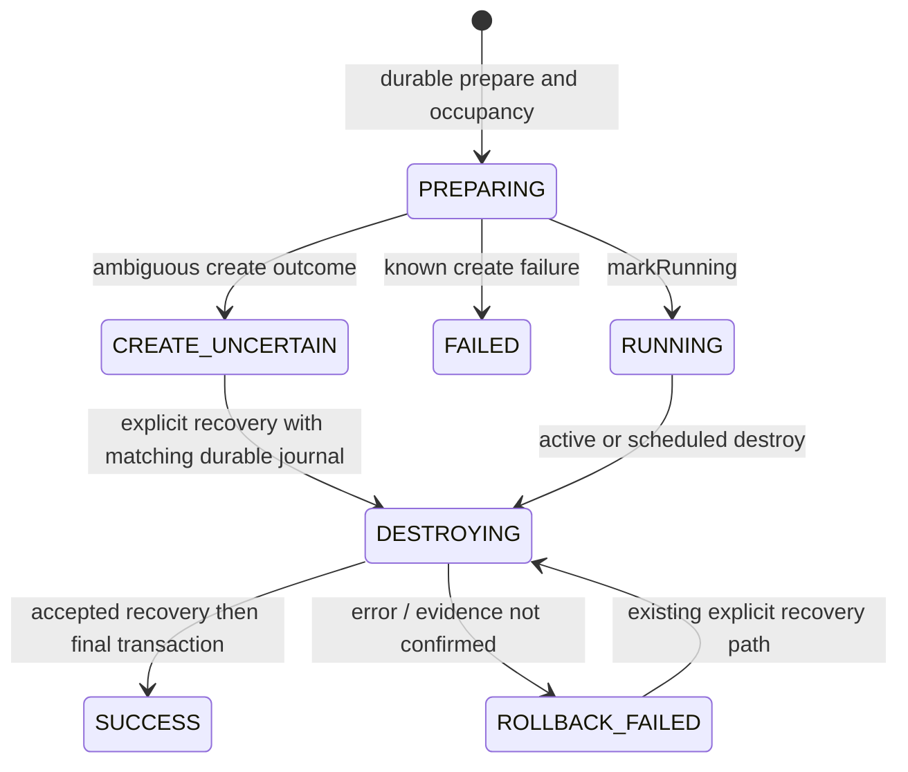
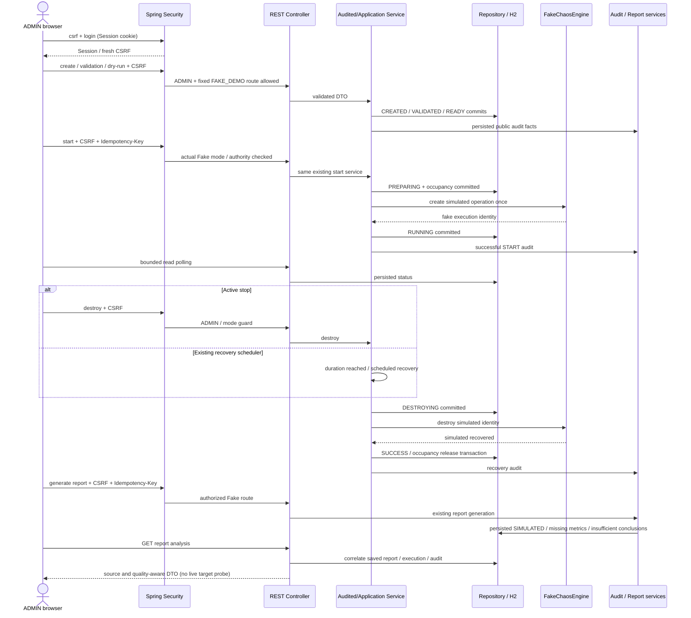
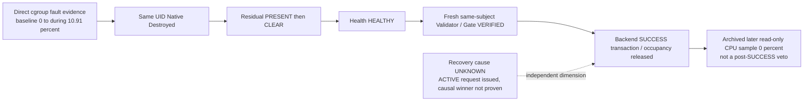

# V1 实际架构（M1–M6）

本图描述当前源码，不是 Kubernetes/Operator 目标架构。旧 `02-architecture.md` 是演进设计。
Profile 不只是 UI 开关，服务端 Bean、路由、数据源和权限也不同。

## 三种控制台模式

console 只读白名单不因为 ADMIN 放开业务写；fake-demo 同时要求真实 Session/ADMIN/CSRF、
精确 Fake 写路径、固定模式及实际 Fake 引擎。history-demo 排除 DataSource/JPA/Flyway，只导入归档与身份组件。
本地启动器不装 Prometheus/Grafana、没有包装到真实边界的命令入口。
Prometheus 的指标是另一个配置部署可选能力，不是 Fake 目标的物理指标。

## 两个状态机，不混用状态

对应 `experiment/domain/Experiment.java`。自环幂等检查略去；校验/预检失败保持原状态。

对应 `execution/domain/ExperimentExecution.java`。FAILED / CREATE_UNCERTAIN 是执行状态，
不是 ExperimentStatus。`CREATE_UNCERTAIN` 不自动重试 create；图中的恢复分支只允许已有可信 journal。

M6 没修改这些迁移，也没开放 uncertain 的强制成功/清占用按钮。Fake SUCCESS 是模拟完成；
真实 Blade 的 SUCCESS 条件包含 M1 Core 生产物理恢复证据，不能只凭 native exit/status。

## 一次 Fake 实验时序

## 已完成 M1 Core 的历史证据

这是归档中的历史过程，非当前监控。`docs/evidence/m1-core-real-20261010.json` 不变，
M2 读取器逐字段提供 JSON pointer。Native 时间戳不推导主动 destroy 的因果归属。
真实物理恢复、报告 HTTP 指标充分性、恢复因果是三个不同维度。
